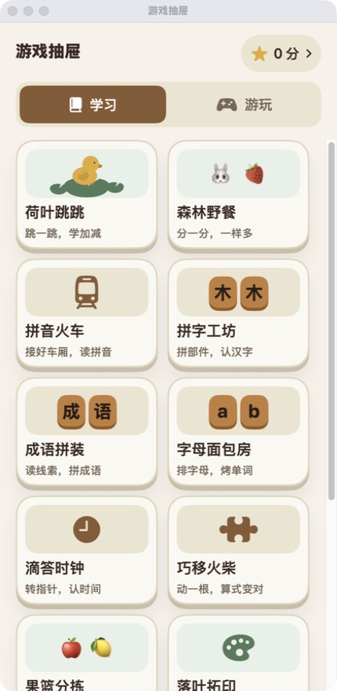
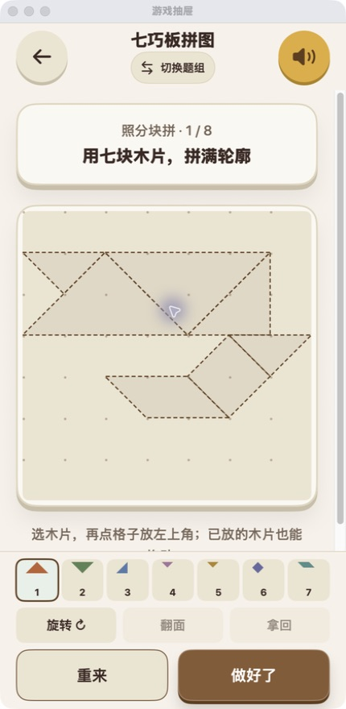

# 游戏抽屉 · Little Learning

给家里小朋友做的简体中文学习小游戏集合。SwiftUI 原生界面，离线使用，没有账号、广告、订阅或后端。

13 款学习与创作游戏，39 个题组，878 个可玩挑战。首次完成关卡获得积分，重复做不重复计分；积分可以手动记录兑换礼物。

<p align="center">
  
  
  
</p>

截图为实际运行的 macOS 预览窗口，与 iOS 共用 SwiftUI 界面；不是设计稿。

## 可以玩什么

| 游戏 | 学习与操作 |
| --- | --- |
| 荷叶跳跳 | 5 以内加减、10 以内加法与减法，24 道精选题 |
| 森林野餐 | 动手平均分、有余数，54 题 |
| 拼音火车 | 声调、复韵母、鼻音、三拼、翘舌与整体认读，65 题 |
| 拼字工坊 | 常见字、偏旁部件、形近字，67 字 |
| 成语拼装 | 根据线索拼成语，30 题 |
| 字母面包房 | 排字母拼单词，80 个单词 |
| 滴答时钟 | 认识时间、分秒与经过时间，121 题 |
| 巧移火柴 | 移动一根火柴使等式成立，281 题 |
| 果篮分拣 | 按水果类型整理，36 关，支持撤销 |
| 落叶拓印 | 选材料、颜色、大小、旋转与力度，自由创作 |
| 七巧板拼图 | 真正的七块木片，拖动、旋转与翻面，24 关 |
| 小鸭送信 | 排前进、左转、右转指令，取信再送信，36 关 |
| 规律串珠 | 找形状与颜色规律，补全珠子，60 关 |

题组按已掌握的知识选择，不强制绑定年级。游戏内可以随时切组，完成后可继续复习；结果与下一题按钮固定在底部。

## 积分与分类

- 「学习／游玩」两个页签，默认进入学习，切换和返回保留列表位置。
- 积分绑定稳定的挑战 ID，同一题重复完成、切换题组或重开都不能刷分。
- 礼物兑换只需填写扣多少积分、换了什么，保留记录，并支持撤销一次。
- 保留可选的趣味游戏时间接口：5 积分换 5 分钟、共用剩余时间、暂停／后台不计时；趣味游戏得分不变成学习积分。

**公开仓库不包含私人版本使用的泡泡龙、合成大西瓜源码或素材。**这些上游项目的再分发授权未完整确认，因此克隆后「游玩」列表为空，13 款原生游戏可直接构建。接入自己有权使用的 HTML5 游戏，见 [可选游戏接入说明](ios/LittleLearning/Sources/WebGames/README.md)。本仓库的 MIT 授权不替代第三方游戏的授权。

## 在 iPhone 上运行

需要 macOS、Xcode，以及 iOS 17 或更新系统。

```bash
git clone https://github.com/yangyao/little-learning.git
cd little-learning
open ios/LittleLearning/LittleLearning.xcodeproj
```

1. 选择 `LittleLearning` target，在 Signing & Capabilities 中选择自己的 Team。
2. 将 Bundle Identifier 改成自己的唯一标识。
3. 连接手机，选择设备并运行。按系统提示完成开发者模式与开发者信任。

可使用 Apple Account 的 Personal Team 进行个人真机开发，也可直接运行模拟器。仓库不包含签名证书或开发者账号配置。

## Mac 预览与检查

```bash
cd ios/LittleLearning
zsh scripts/package_mac_preview.sh
open build/游戏抽屉.app

zsh scripts/check_core.sh
zsh scripts/check_store.sh
```

新增 Swift 文件后运行 `python3 scripts/generate_project.py` 更新 Xcode 文件引用。原生游戏无需第三方包管理器或网络服务。

## 代码与设计

```text
ios/LittleLearning/
  Core/           题库、游戏规则、积分及可序列化状态
  Sources/        SwiftUI 界面、离线 HTML5 容器
  Checks/         规则与存档回归检查
  Assets.xcassets/ 应用图标
  scripts/        项目生成、验证与预览打包
  Sources/WebGames/ 可选游戏接入目录（不分发第三方游戏）
design/           设计 token 与生成脚本
DESIGN.md         木质风格、布局和交互规范
```

所有记录保存在本机应用支持目录，不上传服务器。公开版使用独立 Bundle Identifier 和 `LittleLearning` 存档目录。删除 App／本机存档会丢失学习记录；目前没有云同步。

这个项目由家长按实际体验持续调整，不是完整课程或年级教学标准。欢迎通过 Issue / PR 补充玩法、题目与可访问性改进。

## License

[MIT](LICENSE) · Copyright © 2026 yangyao。仅覆盖本仓库提供的原创代码与资源；系统符号、Emoji 由运行平台提供。未随仓库分发的第三方游戏不在此授权范围内。
