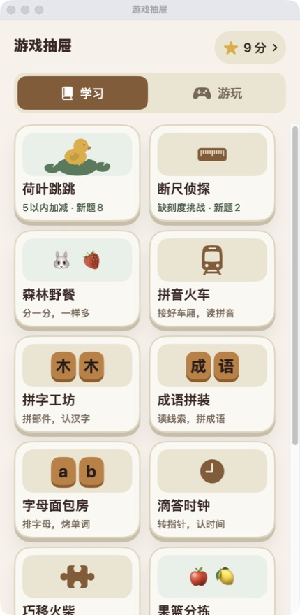
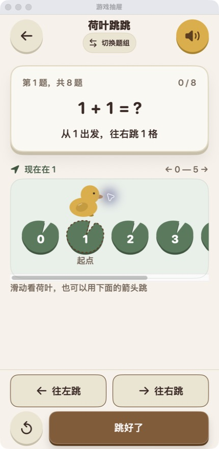
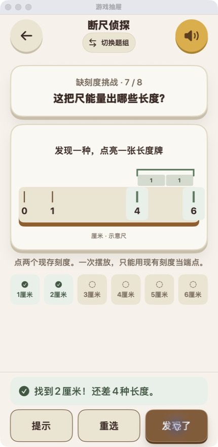
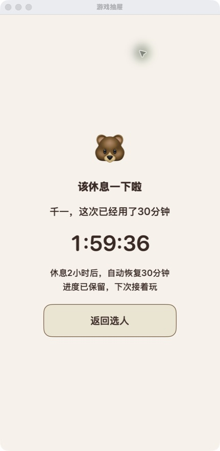
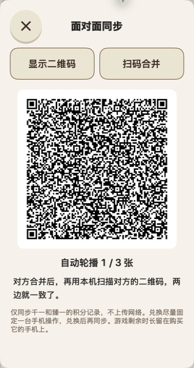
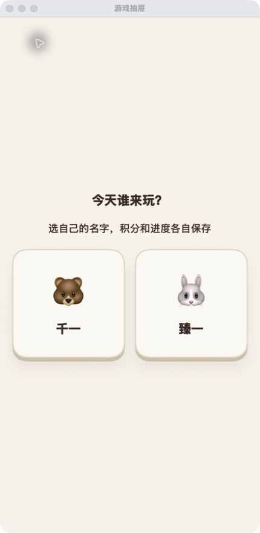

# 千臻乐园 · Little Learning

给家里小朋友做的简体中文学习小游戏集合。SwiftUI 原生界面，离线优先，没有账号、广告或订阅。原生游戏不依赖服务器；仓库另提供可自托管的 [NAS 积分同步服务](server/README.md)。

13 款学习游戏，42 个题组，902 个可玩挑战。首次完成关卡获得积分，重复做不重复计分；积分可以手动记录兑换礼物。

<p align="center">
  
  
  
</p>

截图为实际运行的 macOS 预览窗口，与 iOS 共用 SwiftUI 界面；不是设计稿。

## 可以玩什么

| 游戏 | 学习与操作 |
| --- | --- |
| 荷叶跳跳 | 5 以内加减、10 以内加法与减法，24 道精选题 |
| 断尺侦探 | 对齐测量、补刻度数字、无零断尺与缺刻度探索，24 关 |
| 森林野餐 | 动手平均分、有余数，54 题 |
| 拼音火车 | 声调、复韵母、鼻音、三拼、翘舌与整体认读，65 题 |
| 拼字工坊 | 常见字、偏旁部件、形近字，67 字 |
| 成语拼装 | 根据线索拼成语，30 题 |
| 字母面包房 | 排字母拼单词，80 个单词 |
| 滴答时钟 | 认识时间、分秒与经过时间，121 题 |
| 巧移火柴 | 移动一根火柴使等式成立，281 题 |
| 果篮分拣 | 按水果类型整理，36 关，支持撤销 |
| 七巧板拼图 | 真正的七块木片，拖动、旋转与翻面，24 关 |
| 小鸭送信 | 排前进、左转、右转指令，取信再送信，36 关 |
| 规律串珠 | 找形状与颜色规律，补全珠子，60 关 |

题组按已掌握的知识选择，不强制绑定年级。游戏内可以随时切组，完成后可继续复习；结果与下一题按钮固定在底部。

## 使用30分钟，休息2小时（2.4）

千一、臻一分别计时，学习和游玩共用30分钟；选人页、后台、锁屏暂停。用完保存进度并强制休息2小时，到时自动恢复30分钟。抽屉显示剩余时间，最后1分钟提醒；没有加时、解锁或家长设置入口。每台手机独立计时，积分同步不会重置额度。

<p align="center"></p>

## NAS 积分同步服务

[`server/`](server/README.md) 使用 Go＋SQLite，可编译成单一 Linux ARM64 二进制部署到家用 NAS。它提供积分账本协议、测试、历史迁移工具和 QNAP 自启动包装。

| 内容 | 当前仓库状态 |
| --- | --- |
| iOS／macOS 客户端 | 原生游戏离线运行，积分使用下文的二维码面对面同步 |
| NAS 服务端 | 已提供积分同步、在线兑换、迁移和备份 API；客户端接入方式见服务文档 |
| QNAP 启动管理 | 提供 QDK 包装源码，可由 App Center 管理启用、停用及开机启动 |

**仓库中的 iOS 客户端尚未接入 NAS API。** 部署服务不会自动替换现有二维码入口；下面的 NAS 行为需要客户端按协议接入，不能把二维码合并流程直接指向服务地址。

接入后的同步规则：

- 学习、通关和得分保留在本机，离线可用；联网后上传新奖项，按孩子与挑战 ID 去重。
- 新兑换和撤销由服务器事务确认；客户端持久化请求 UUID，超时或重启后重试同一笔，避免重复扣分和并发透支。
- 购买的游玩分钟只发给请求设备一次；进行中的棋盘、剩余游玩时间和使用额度各机独立。

在仓库根目录构建与检查服务：

```sh
cd server
go test -race ./...
go build -o learning-server ./cmd/learning-server
python3 scripts/check_http.py ./learning-server
cp config.example.json config.json
```

运行前编辑 config.json：设置 NAS 的固定局域网监听地址，并替换至少32字符的随机令牌；客户端使用相同令牌。示例默认只监听本机。令牌配置、数据库、原始存档及迁移输出都不应提交到公开仓库。随后运行 `./learning-server -config config.json`；Linux／NAS 也可使用 `./start.sh` 在退出 SSH 后继续运行服务。

QNAP 可用官方 QDK 构建 [App Center 管理包装](server/deploy/qpkg/README.md)，经管理员权限安装后注册开机启动；既可从 App Center 手动安装，也可先把包复制到 NAS 再在 NAS 本机执行 `sudo /bin/sh /path/to/package.qpkg`。构建前需核对包装中的部署路径和运行用户。完整协议、ARM64 构建、迁移及一致备份说明见 [服务端 README](server/README.md)。

## 面对面同步（当前 iOS 客户端，2.3）

抽屉顶部点二维码图标：A显示二维码 → B扫码并确认合并 → A再扫描B的回传二维码。两人的首次得分、兑换、撤销和游戏时间购买支出会合并，重复扫描不重复加分或扣分。记录多时自动轮播二维码，保持相机对准即可，无需联网。

游戏进度和剩余游玩时间留在本机；兑换尽量固定一台手机操作。若双方离线支出超过合计积分，会保留原记录并提示先撤销重复兑换。首次扫描需允许相机权限。

<p align="center"></p>

## 双人使用（2.2）

固定「千一／臻一」两个名字，打开先选人，抽屉左上角随时切换。每人的积分、兑换、题组、关卡进度和游玩时间独立；同一关每个孩子可以各得一次积分。旧存档自动归臻一，千一从零开始，旧文件保留。无需创建账号或设置。

<p align="center"></p>

## 断尺侦探（2.1）

三组各8关：量一量（6道移动测量＋2道补数字）、没有零也能量（8道断尺测量）、缺刻度挑战（6道目标长度＋2道找齐所有可测长度）。尺子可拖动，也可用箭头对齐；缺刻度关只允许用现有刻度作端点，一次摆放完成测量。

所有正确端点组合都接受。提示把长度分成单位间隔，说明数的是间隔而不是刻线。探索关记录已发现长度，重复发现不增加完成数，找齐后才通关。普通关首次完成+1，完整探索关+3；重做、复习、重开不重复计分。

## 积分与分类

- 「学习／游玩」两个页签，默认进入学习，切换和返回保留列表位置。
- 积分绑定稳定的挑战 ID，同一题重复完成、切换题组或重开都不能刷分。
- 礼物兑换只需填写扣多少积分、换了什么，保留记录，并支持撤销一次。
- 保留可选的趣味游戏时间接口：5 积分换 5 分钟、共用剩余时间、暂停／后台不计时；趣味游戏得分不变成学习积分。

**公开仓库不包含私人版本使用的泡泡龙、合成大西瓜源码或素材。**这些上游项目的再分发授权未完整确认，因此克隆后「游玩」列表为空，13 款原生游戏可直接构建。接入自己有权使用的 HTML5 游戏，见 [可选游戏接入说明](ios/LittleLearning/Sources/WebGames/README.md)。本仓库的 MIT 授权不替代第三方游戏的授权。

## 在 iPhone 上运行

需要 macOS、Xcode，以及 iOS 17 或更新系统。

```bash
git clone https://github.com/yangyao/little-learning.git
cd little-learning
open ios/LittleLearning/LittleLearning.xcodeproj
```

1. 选择 `LittleLearning` target，在 Signing & Capabilities 中选择自己的 Team。
2. 将 Bundle Identifier 改成自己的唯一标识。
3. 连接手机，选择设备并运行。按系统提示完成开发者模式与开发者信任。

可使用 Apple Account 的 Personal Team 进行个人真机开发，也可直接运行模拟器。仓库不包含签名证书或开发者账号配置。

## Mac 预览与检查

```bash
cd ios/LittleLearning
zsh scripts/package_mac_preview.sh
open build/千臻乐园.app

zsh scripts/check_core.sh
zsh scripts/check_store.sh
```

新增 Swift 文件后运行 `python3 scripts/generate_project.py` 更新 Xcode 文件引用。原生游戏无需第三方包管理器或网络服务。

## 代码与设计

```text
ios/LittleLearning/
  Core/           题库、游戏规则、积分及可序列化状态
  Sources/        SwiftUI 界面、离线 HTML5 容器
  Checks/         规则与存档回归检查
  Assets.xcassets/ 应用图标
  scripts/        项目生成、验证与预览打包
  Sources/WebGames/ 可选游戏接入目录（不分发第三方游戏）
server/
  cmd/learning-server/  Go HTTP 服务入口
  internal/syncdb/      SQLite 账本、奖励规则与事务检查
  scripts/              HTTP 验证与历史迁移工具
  deploy/qpkg/          QNAP App Center 自启动包装源码
design/           设计 token 与生成脚本
DESIGN.md         木质风格、布局和交互规范
```

落叶拓印已从抽屉移除，旧作品数据仅保留作存档兼容，不再提供入口。

当前仓库的 iOS 客户端将记录保存在本机应用支持目录，不自动上传服务器；公开版使用独立 Bundle Identifier 和 `LittleLearning` 存档目录。二维码合并需主动操作。接入 NAS 的客户端可以同步积分账本，游戏中间状态与设备时长仍留在本机。删除 App／本机存档会丢失未备份、未同步的数据，NAS 账本不能恢复完整游戏存档。

这个项目由家长按实际体验持续调整，不是完整课程或年级教学标准。欢迎通过 Issue / PR 补充玩法、题目与可访问性改进。

## License

[MIT](LICENSE) · Copyright © 2026 yangyao。仅覆盖本仓库提供的原创代码与资源；系统符号、Emoji 由运行平台提供。未随仓库分发的第三方游戏不在此授权范围内。
